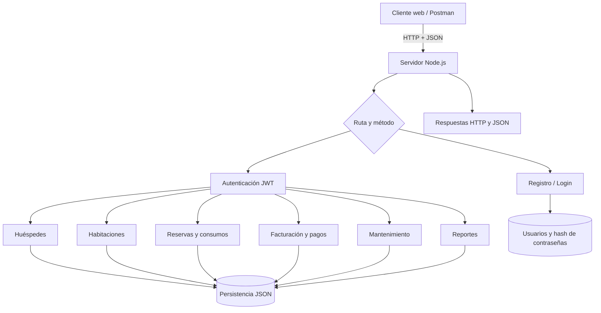

# Diseño de la arquitectura de servicios

## Capas

1. **Cliente web:** `index.html`, `css/styles.css`, `js/app.js`. La interfaz utiliza la API para autenticar y validar el perfil. Las operaciones principales están disponibles en el backend y se pueden consumir desde Postman o integrar a continuación en cada pantalla.
2. **Servidor HTTP Node.js:** `api/server.js` recibe solicitudes REST, analiza JSON, aplica validaciones, autentica tokens y devuelve respuestas con códigos HTTP.
3. **Servicios de dominio:** autenticación y usuarios; huéspedes; habitaciones; reservas; catálogo de servicios; facturación y pagos; mantenimiento; reportes.
4. **Persistencia académica:** documentos JSON en `api/data/`. Se generan al arrancar por primera vez y se excluyen del repositorio con `.gitignore` para no publicar datos locales.
5. **Validación y documentación:** Postman, `scripts/api-test.js`, `docs/API_REFERENCE.md`, `docs/openapi.json` y `docs/ENDPOINTS_API.txt`.

## Diagrama (Mermaid)

## Relaciones principales

- Un huésped puede tener múltiples reservas.
- Una reserva corresponde a un huésped y una habitación para un rango de fechas.
- La reserva puede registrar múltiples consumos de servicios adicionales.
- En esta versión una reserva solo puede generar una factura.
- Una factura puede registrar uno o varios pagos parciales, hasta completar su total.
- Una solicitud de mantenimiento puede vincularse opcionalmente con una habitación o área.
- El reporte gerencial calcula indicadores usando los recursos guardados.

## Decisiones de diseño

- UUID para identificar recursos sin depender de números secuenciales.
- Rutas REST con sustantivos plurales para colecciones y subrutas para operaciones relacionadas (por ejemplo, servicios de una reserva y pagos de una factura).
- Token Bearer de una hora para autenticar consultas de negocio.
- Validaciones explícitas sobre fechas, capacidad, disponibilidad, duplicados y pagos.
- Códigos HTTP para distinguir errores de entrada, ausencia de sesión, permisos, inexistencia y conflictos.
- Formato JSON de respuesta uniforme para simplificar el consumo desde otros clientes.

## Limitación y siguiente paso

El almacén JSON favorece que el proyecto se ejecute sin instalar un motor de base de datos. Para un despliegue real se recomienda migrar a PostgreSQL/MySQL u otra base persistente con transacciones, y agregar pruebas de concurrencia, auditoría, rate limiting y configuración segura de CORS.
